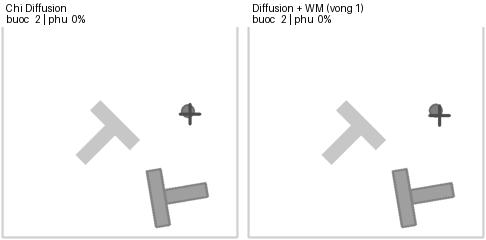
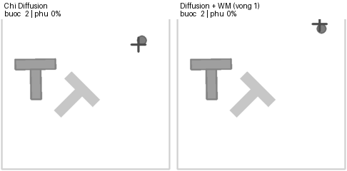
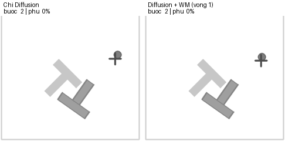

# PushT World Model

Mã nguồn và tư liệu cho project học quy luật tương tác giữa robot và vật thể trong bài toán PushT.

## Xem nhanh

- [Notebook có code và output lưu sẵn](PushT_WorldModel.ipynb)
- [Bản HTML của notebook để tải về xem offline](PushT_WorldModel.html)
- [Mã ước lượng tư thế khối T](pusht_pose.py)
- [Ảnh và GIF trích trực tiếp từ output notebook](results/notebook_figures/)
- [Ảnh được lưu trong thư mục kết quả trên máy](PushT/results/)
- [Log output đã lưu trong notebook](results/notebook_stdout.txt)
- [Video quay màn hình gốc](media/screen_recording_original.mp4)
- [Dữ liệu đã xử lý](PushT/data/sim/)
- [Các checkpoint thực sự có trên máy](PushT/models/)
- [Danh mục tệp và mã kiểm tra toàn vẹn](ARTIFACT_MANIFEST.json)

## Nguồn và hiện trạng

Notebook được người nộp nhận từ người khác để tìm hiểu phương pháp. Các output, hình, GIF và số liệu lưu sẵn thuộc lần chạy đi kèm tài liệu tham khảo; **không phải một lần chạy lại toàn bộ đã được người nộp xác nhận**. Repository giữ các tư liệu hiện có để giảng viên có thể kiểm tra nội dung, đồng thời phân biệt nguồn trong phần dưới.

Các chỉnh sửa vận hành đã áp dụng gồm đường dẫn dữ liệu theo thư mục dự án, đúng tên biểu đồ khi nạp kết quả, kiểm tra đủ dữ liệu/video khi tải và xử lý sai số làm tròn của thanh sai số biểu đồ. Báo cáo Word/PDF được nộp riêng, không đưa vào repository.

### Phân biệt các nhóm tư liệu

| Nhóm | Nguồn và giới hạn |
|---|---|
| Notebook, output và GIF demo | Tài liệu được cung cấp; chỉ dùng làm kết quả tham khảo |
| `results/notebook_figures` và log | Tách nguyên dữ liệu ảnh/log đã lưu trong notebook, không chạy lại huấn luyện |
| `PushT/results` và `PushT/data/sim` | Các tệp thực sự có trong thư mục dự án tại lúc đóng gói; không mặc định cùng một lần chạy với output lưu trong notebook |
| `PushT/data/raw` và `raw_keypoints` | Bản dữ liệu đã tải từ Hugging Face, không phải demo do người nộp tạo |
| `PushT/models` | Có `wm.pt` và checkpoint Diffusion e025, e050, e075, e100, e125; không có mô hình cuối cùng `dp_final.pt` hoặc `wm_iter1.pt` |
| Video gốc | Tệp quay màn hình đi kèm hồ sơ, không dùng riêng tệp này để chứng minh hoàn thành huấn luyện |
| Ảnh robot thật | Minh họa bối cảnh bài toán; không phải bằng chứng thử nghiệm phần cứng của người nộp |

Chưa có JSON đánh giá theo từng ván hoặc dữ liệu tự chơi `rollouts_iter1.npz` trong snapshot này. Không tạo thêm tệp giả, trọng số giả hoặc các phép đo chưa thực hiện. Các output tham khảo vẫn được giữ nguyên trong notebook.

## Demo tham khảo

Các clip dưới đây lấy từ bộ tư liệu được cung cấp. Khung trái là Chỉ Diffusion; khung phải là Diffusion kết hợp World Model vòng 1 theo nhãn trong clip. Việc chọn các ván minh họa không thay thế đánh giá trên toàn bộ tập seed.

### Seed 4000



### Seed 4036



### Seed 4093



Video MP4 gốc: [xem hoặc tải tệp](media/screen_recording_original.mp4). GIF được nhúng trực tiếp ở README để giảng viên xem nhanh ngay cả khi trình xem notebook không phát ảnh động. GitHub cũng hỗ trợ video đính kèm theo [hướng dẫn chính thức](https://docs.github.com/en/get-started/writing-on-github/working-with-advanced-formatting/attaching-files). Việc đăng tệp lên GitHub không tự chạy huấn luyện mô hình.

## Nội dung và chiến thuật

1. Tải dữ liệu `lerobot/pusht` và đối chiếu trạng thái, hành động, ảnh.
2. Ước lượng tư thế khối T từ ảnh bằng khớp khuôn hình học và IoU.
3. Huấn luyện World Model dự đoán độ thay đổi tư thế từ trạng thái và hành động; chia theo ván để tránh rò rỉ dữ liệu.
4. Đánh giá so với mốc vật thể đứng yên và kiểm tra các khung thực sự chuyển động.
5. Phần mở rộng sinh ứng viên bằng Diffusion, chọn bằng World Model, thu dữ liệu tự chơi và đánh giá lại.

Sự có mặt của mã hoặc output tham khảo không có nghĩa mọi bước đã được người nộp chạy lại.

## Chạy lại trên Windows

Môi trường đã kiểm tra: Python 3.11.9, PyTorch 2.7.1 với CUDA 11.8. Chọn bản PyTorch phù hợp với GPU và driver.

```powershell
python -m venv .venv
.\.venv\Scripts\python.exe -m pip install --upgrade pip
.\.venv\Scripts\python.exe -m pip install jupyterlab ipykernel numpy gymnasium gym-pusht pandas pyarrow opencv-python av huggingface_hub matplotlib pillow
.\.venv\Scripts\python.exe -m pip install torch==2.7.1 --index-url https://download.pytorch.org/whl/cu118
.\.venv\Scripts\python.exe -X utf8 -m jupyter lab "PushT_WorldModel.ipynb"
```

Trong VS Code phải chọn kernel `.venv/Scripts/python.exe`. Kích hoạt `.venv` ở Terminal không tự đổi kernel của notebook. Chạy lần lượt từ trên xuống. Dữ liệu và kết quả được lưu trong `PushT`.

Các bước nặng dùng lại tệp đã có khi cờ `FORCE` tương ứng là `False`. Đây không phải cơ chế tiếp tục huấn luyện từ giữa epoch: nếu thiếu checkpoint cuối, mã huấn luyện hiện tại có thể chạy lại từ đầu. Cần giữ riêng tư liệu tham khảo và ghi nhận một lần chạy mới khi tái lập. Không giảm `DP_EPOCHS` xuống dưới 175 mà giữ nguyên bước chọn checkpoint.

## Tài liệu tham khảo

- Dataset: https://huggingface.co/datasets/lerobot/pusht
- Dataset keypoints: https://huggingface.co/datasets/lerobot/pusht_keypoints
- Diffusion Policy: https://diffusion-policy.cs.columbia.edu/
- Mã nguồn chính thức: https://github.com/real-stanford/diffusion_policy
- Bài báo: https://arxiv.org/abs/2303.04137
- Tutorial do giảng viên gợi ý: https://learnrobotics.ai/learn/day-17

Nguồn tác giả của notebook tham khảo cần được bổ sung khi được xác nhận. Các nguồn bên ngoài giữ nguyên điều kiện sử dụng và bản quyền tương ứng. Bộ dữ liệu gốc được ghi nguồn trong metadata và README kèm theo.
